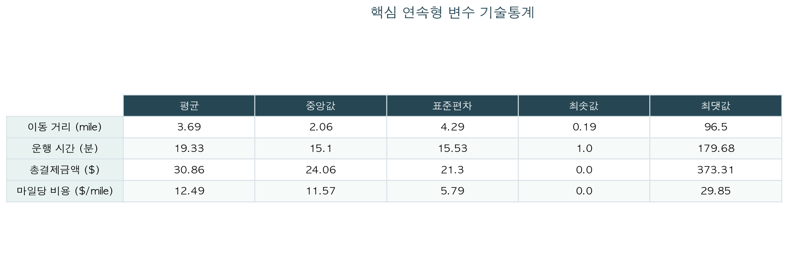
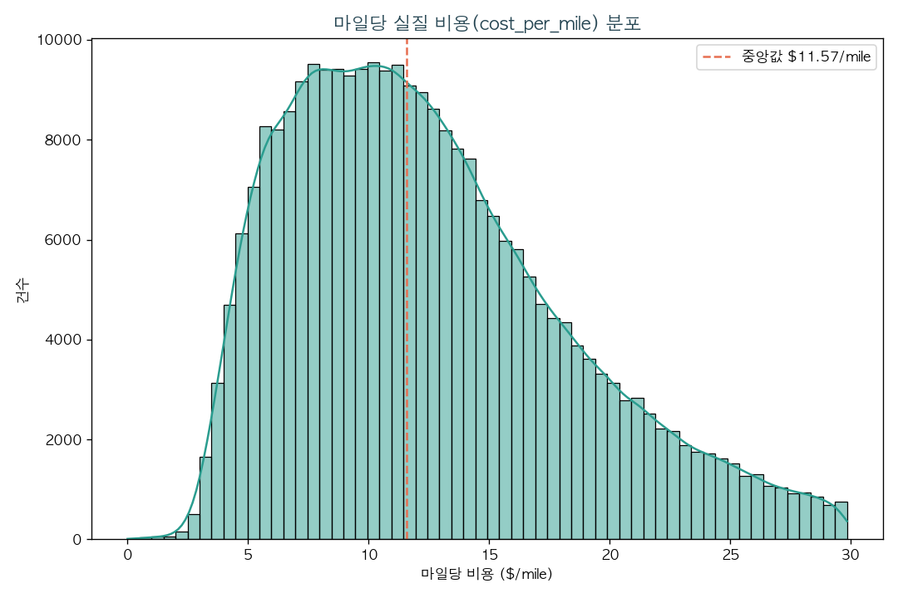
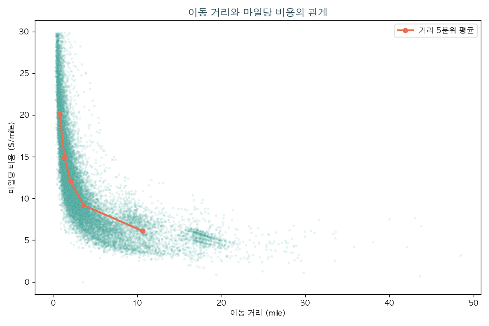
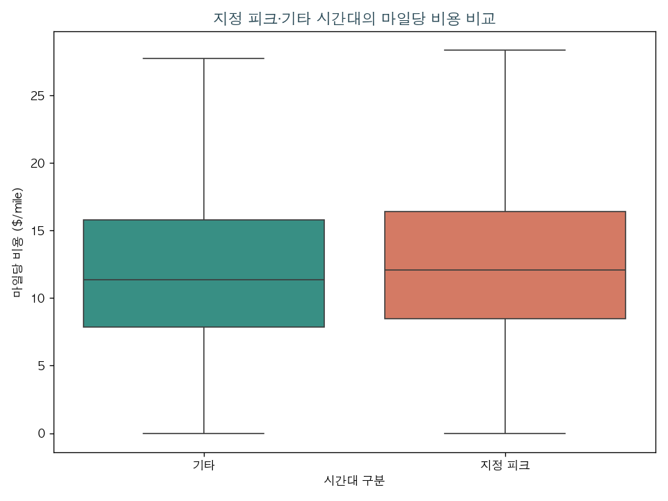
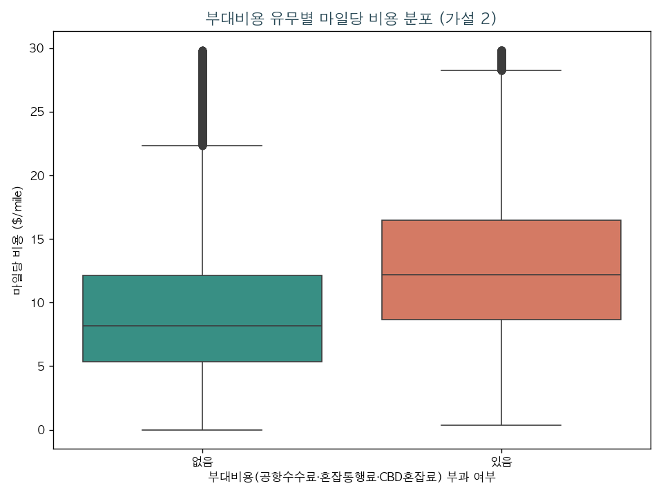
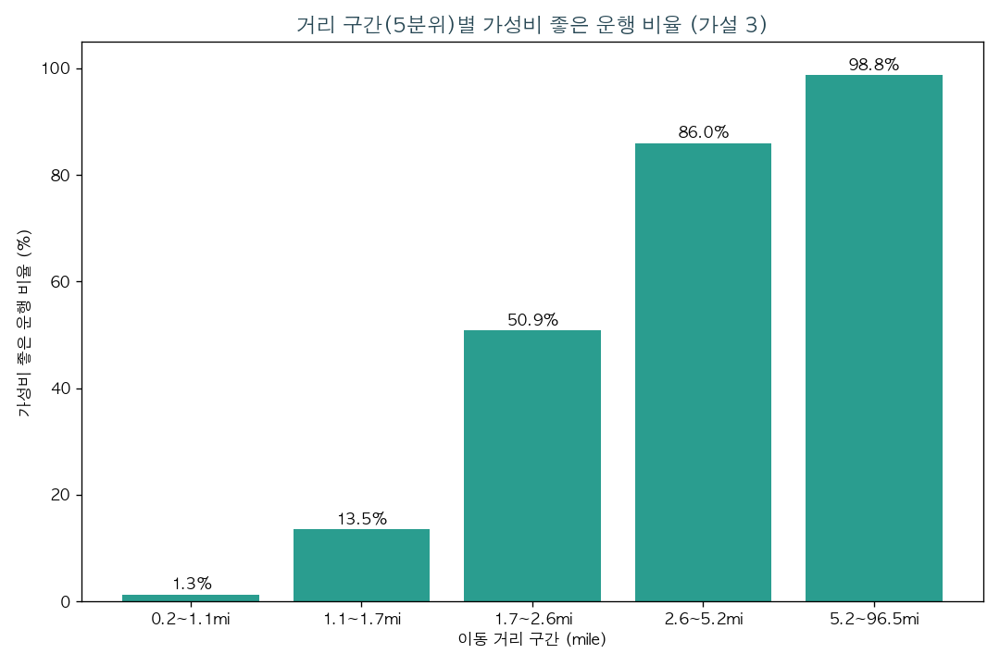
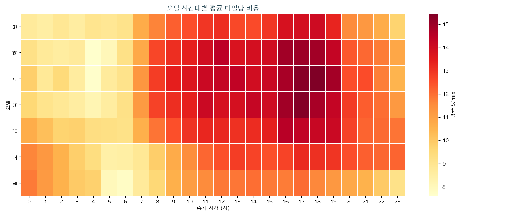
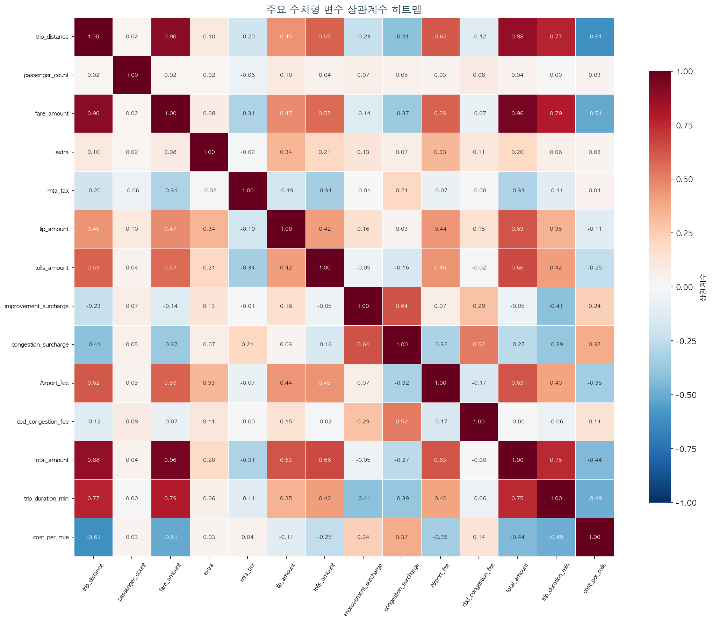
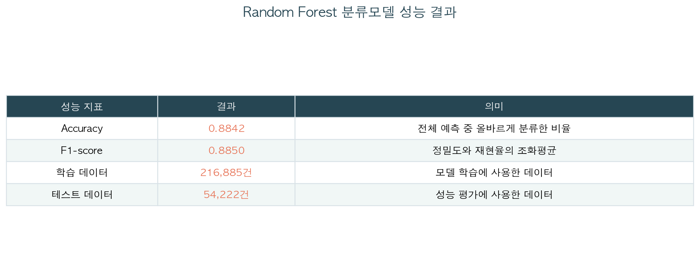

# NYC Yellow Taxi (2026-05) - 가성비 좋은 택시 탑승 조건 분석 리포트

- 생성 시각: 2026-08-06 18:59:32
- 원본 데이터: https://d37ci6vzurychx.cloudfront.net/trip-data/yellow_tripdata_2026-05.parquet
- 핵심 지표: cost_per_mile = total_amount / trip_distance

## 1. 데이터 로딩 비교 (Pandas vs Polars)
- Pandas: shape=(4090836, 20), 로딩 0.51s, 메모리 777.5MB
- Polars: shape=(4090836, 20), 로딩 0.19s, 메모리 550.1MB
- 두 결과 shape 일치 여부: True

## 2. 결측치·중복·이상치 처리
- 원본 행 수: 300,000
- 컬럼별 결측치 개수 (isnull().sum()):
| 컬럼                  |   결측치 개수 |
|:----------------------|--------------:|
| VendorID              |             0 |
| tpep_pickup_datetime  |             0 |
| tpep_dropoff_datetime |             0 |
| passenger_count       |         70180 |
| trip_distance         |             0 |
| RatecodeID            |         70180 |
| store_and_fwd_flag    |         70180 |
| PULocationID          |             0 |
| DOLocationID          |             0 |
| payment_type          |             0 |
| fare_amount           |             0 |
| extra                 |             0 |
| mta_tax               |             0 |
| tip_amount            |             0 |
| tolls_amount          |             0 |
| improvement_surcharge |             0 |
| total_amount          |             0 |
| congestion_surcharge  |         70180 |
| Airport_fee           |         70180 |
| cbd_congestion_fee    |             0 |
- 중복 제거: 0건
- 비정상값 제외: 16,319건
- cost_per_mile IQR 이상치 제외: 12,574건 (정상범위 0.00 ~ 29.85 $/mile)
  - 1.5xIQR 공식상 하한이 음수로 계산되지만 마일당 비용은 음수가 될 수 없어 하한을 0으로 보정 -> 실질적으로는 상한 초과 극단치(초단거리 고액 운행 등)만 제거됨
- 마일당 비용 중앙값(is_cost_effective 기준): $11.57/mile
  - 가성비 라벨을 중앙값 분할(median split)로 정한 이유: 임의의 절대 임계값을 피하고, 클래스가 자동으로 50:50 균형을 이뤄 분류 모델 학습에 유리하기 때문
- 최종 행 수: 271,107

## 3. 기술통계
|                       |   mean |   std |   min |   25% |   50% |   75% |    max |
|:----------------------|-------:|------:|------:|------:|------:|------:|-------:|
| trip_distance         |   3.69 |  4.29 |  0.19 |  1.2  |  2.06 |  4.18 |  96.5  |
| passenger_count       |   1.19 |  0.56 |  1    |  1    |  1    |  1    |   6    |
| fare_amount           |  21.76 | 17.02 |  3    | 10.7  | 16.3  | 26.8  | 300    |
| extra                 |   1.16 |  1.77 |  0    |  0    |  0    |  2.5  |  15.25 |
| mta_tax               |   0.5  |  0.05 |  0    |  0.5  |  0.5  |  0.5  |   4.75 |
| tip_amount            |   3.05 |  3.98 |  0    |  0    |  2.38 |  4.2  | 100    |
| tolls_amount          |   0.58 |  2.23 |  0    |  0    |  0    |  0    |  74.31 |
| improvement_surcharge |   0.96 |  0.19 |  0    |  1    |  1    |  1    |   1    |
| congestion_surcharge  |   2.22 |  0.78 |  0    |  2.5  |  2.5  |  2.5  |   2.5  |
| Airport_fee           |   0.17 |  0.56 |  0    |  0    |  0    |  0    |   2    |
| cbd_congestion_fee    |   0.5  |  0.35 |  0    |  0    |  0.75 |  0.75 |   0.75 |
| total_amount          |  30.86 | 21.3  |  0    | 17.95 | 24.06 | 35.03 | 373.31 |
| trip_duration_min     |  19.33 | 15.53 |  1    |  9.3  | 15.1  | 23.97 | 179.68 |
| cost_per_mile         |  12.49 |  5.79 |  0    |  7.99 | 11.57 | 15.98 |  29.85 |

## 4. 범주형/메타데이터 컬럼 요약
- **VendorID**
|    |   VendorID |   건수 |
|---:|-----------:|-------:|
|  0 |          2 | 216094 |
|  1 |          1 |  54559 |
|  2 |          6 |    454 |
- **RatecodeID**
|    |   RatecodeID |   건수 |
|---:|-------------:|-------:|
|  0 |            1 | 191153 |
|  1 |          nan |  60841 |
|  2 |           99 |  10293 |
|  3 |            2 |   6441 |
|  4 |            5 |    995 |
|  5 |            3 |    790 |
|  6 |            4 |    594 |
- **store_and_fwd_flag**
|    | store_and_fwd_flag   |   건수 |
|---:|:---------------------|-------:|
|  0 | N                    | 210032 |
|  1 |                      |  60841 |
|  2 | Y                    |    234 |
- **payment_type**
|    |   payment_type |   건수 |
|---:|---------------:|-------:|
|  0 |              1 | 184697 |
|  1 |              0 |  60841 |
|  2 |              2 |  24407 |
|  3 |              4 |    727 |
|  4 |              3 |    435 |
- **is_peak_hour**
|    | is_peak_hour   |   건수 |
|---:|:---------------|-------:|
|  0 | False          | 200850 |
|  1 | True           |  70257 |
- **has_surcharge**
|    | has_surcharge   |   건수 |
|---:|:----------------|-------:|
|  0 | True            | 227633 |
|  1 | False           |  43474 |
- **is_late_night**
|    | is_late_night   |   건수 |
|---:|:----------------|-------:|
|  0 | False           | 216994 |
|  1 | True            |  54113 |
- **is_cost_effective**
|    |   is_cost_effective |   건수 |
|---:|--------------------:|-------:|
|  0 |                   1 | 135554 |
|  1 |                   0 | 135553 |

## 5. 상관계수
|                       |   trip_distance |   passenger_count |   fare_amount |   extra |   mta_tax |   tip_amount |   tolls_amount |   improvement_surcharge |   congestion_surcharge |   Airport_fee |   cbd_congestion_fee |   total_amount |   trip_duration_min |   cost_per_mile |
|:----------------------|----------------:|------------------:|--------------:|--------:|----------:|-------------:|---------------:|------------------------:|-----------------------:|--------------:|---------------------:|---------------:|--------------------:|----------------:|
| trip_distance         |            1    |              0.02 |          0.9  |    0.1  |     -0.2  |         0.45 |           0.59 |                   -0.23 |                  -0.41 |          0.62 |                -0.12 |           0.88 |                0.77 |           -0.61 |
| passenger_count       |            0.02 |              1    |          0.02 |    0.02 |     -0.06 |         0.1  |           0.04 |                    0.07 |                   0.05 |          0.03 |                 0.08 |           0.04 |                0    |            0.03 |
| fare_amount           |            0.9  |              0.02 |          1    |    0.08 |     -0.31 |         0.47 |           0.57 |                   -0.14 |                  -0.37 |          0.59 |                -0.07 |           0.96 |                0.79 |           -0.51 |
| extra                 |            0.1  |              0.02 |          0.08 |    1    |     -0.02 |         0.34 |           0.21 |                    0.13 |                   0.07 |          0.33 |                 0.11 |           0.2  |                0.06 |            0.03 |
| mta_tax               |           -0.2  |             -0.06 |         -0.31 |   -0.02 |      1    |        -0.19 |          -0.34 |                   -0.01 |                   0.21 |         -0.07 |                -0    |          -0.31 |               -0.11 |            0.04 |
| tip_amount            |            0.45 |              0.1  |          0.47 |    0.34 |     -0.19 |         1    |           0.42 |                    0.16 |                   0.03 |          0.44 |                 0.15 |           0.63 |                0.35 |           -0.11 |
| tolls_amount          |            0.59 |              0.04 |          0.57 |    0.21 |     -0.34 |         0.42 |           1    |                   -0.05 |                  -0.16 |          0.45 |                -0.02 |           0.66 |                0.42 |           -0.25 |
| improvement_surcharge |           -0.23 |              0.07 |         -0.14 |    0.13 |     -0.01 |         0.16 |          -0.05 |                    1    |                   0.64 |          0.07 |                 0.29 |          -0.05 |               -0.41 |            0.24 |
| congestion_surcharge  |           -0.41 |              0.05 |         -0.37 |    0.07 |      0.21 |         0.03 |          -0.16 |                    0.64 |                   1    |         -0.32 |                 0.52 |          -0.27 |               -0.39 |            0.37 |
| Airport_fee           |            0.62 |              0.03 |          0.59 |    0.33 |     -0.07 |         0.44 |           0.45 |                    0.07 |                  -0.32 |          1    |                -0.17 |           0.63 |                0.4  |           -0.35 |
| cbd_congestion_fee    |           -0.12 |              0.08 |         -0.07 |    0.11 |     -0    |         0.15 |          -0.02 |                    0.29 |                   0.52 |         -0.17 |                 1    |          -0    |               -0.06 |            0.14 |
| total_amount          |            0.88 |              0.04 |          0.96 |    0.2  |     -0.31 |         0.63 |           0.66 |                   -0.05 |                  -0.27 |          0.63 |                -0    |           1    |                0.75 |           -0.44 |
| trip_duration_min     |            0.77 |              0    |          0.79 |    0.06 |     -0.11 |         0.35 |           0.42 |                   -0.41 |                  -0.39 |          0.4  |                -0.06 |           0.75 |                1    |           -0.49 |
| cost_per_mile         |           -0.61 |              0.03 |         -0.51 |    0.03 |      0.04 |        -0.11 |          -0.25 |                    0.24 |                   0.37 |         -0.35 |                 0.14 |          -0.44 |               -0.49 |            1    |

핵심 해석:
- cost_per_mile ↔ trip_distance: -0.61 -> trip_distance이(가) 클수록 마일당 비용이 낮아지는(음의 상관) 경향
- cost_per_mile ↔ fare_amount: -0.51 -> fare_amount이(가) 클수록 마일당 비용이 낮아지는(음의 상관) 경향
- cost_per_mile ↔ trip_duration_min: -0.49 -> trip_duration_min이(가) 클수록 마일당 비용이 낮아지는(음의 상관) 경향

## 6. 시각화
### 6-1. 핵심 변수 기술통계표
콘솔과 보고서에 사용한 기술통계를 발표용 표 이미지로 정리.

### 6-2. 마일당 비용 분포 (Seaborn)
핵심 지표 cost_per_mile의 분포 형태와 중앙값(가성비 기준선) 위치를 확인.

### 6-3. 이동 거리와 마일당 비용 관계 (Seaborn)
고정 표본 2만 건 산점도와 H3 거리 5분위별 실제 평균선으로 관계를 탐색.

### 6-4. 지정 피크·기타 시간대 분포 박스플롯 (Seaborn)
가설 1의 두 집단에서 중앙값과 사분위 범위가 어떻게 다른지 확인.

### 6-5. 부대비용 유무별 분포 박스플롯 (Seaborn)
가설 2의 t-test는 평균 차이만 보여주므로, 두 그룹의 분포 전체가 실제로 벌어져 있는지를 박스플롯으로 확인.

### 6-6. 거리 구간별 가성비 비율 (가설 3)
거리 5분위 구간별 가성비 좋은 운행 비율 -> 거리에 따라 비율이 비선형적으로 변하는 패턴을 확인.

### 6-7. 요일·시간대별 평균 마일당 비용
요일과 24시간 조합의 평균 비용 패턴을 한 화면에서 비교.

### 6-8. 주요 수치형 변수 상관계수
상관계수의 크기와 방향을 색상과 숫자로 함께 비교.

### 6-9. 시간대별 평균 마일당 비용 (Plotly 인터랙티브)
- `group_plotly.html`에서 지정 피크·기타 시간대의 평균 마일당 비용을 비교

## 7. 가설 1 - t-test (지정 피크 vs 기타 시간대 마일당 비용)
- 집단 정의: 요일 구분 없이 08~09시와 18~20시를 지정 피크 시간대로 분류하므로 주말도 포함
- 지정 피크 평균: $12.929/mile / 기타 시간대 평균: $12.339/mile
- t=23.2675, p=8.603e-120 (one-sided)
- 결론: 귀무가설 기각 (지정 피크 시간대가 유의미하게 높음)

## 8. 가설 2 - t-test (부대비용 유무별 마일당 비용)
- 부대비용 있음 평균: $13.062/mile / 부대비용 없음 평균: $9.507/mile
- t=123.8463, p=0 (one-sided)
- 결론: 귀무가설 기각 (부대비용 있는 운행이 유의미하게 높음)
- 해석 한계: 요금 컬럼 결측 60,841건 중 28,873건은 현재 비교식에서 '부대비용 없음'으로 분류됨

## 9. 가설 3 - 거리 구간별 가성비 비율
| distance_bucket   |   평균거리 |   평균마일당비용 |   가성비비율 |   건수 |
|:------------------|-----------:|-----------------:|-------------:|-------:|
| (0.189, 1.07]     |      0.785 |           20.099 |        0.013 |  54591 |
| (1.07, 1.66]      |      1.354 |           14.95  |        0.135 |  53869 |
| (1.66, 2.6]       |      2.086 |           12.055 |        0.509 |  54624 |
| (2.6, 5.2]        |      3.628 |            9.186 |        0.86  |  54040 |
| (5.2, 96.5]       |     10.657 |            6.096 |        0.988 |  53983 |
- 비율이 구간마다 일정하게 증가/감소하지 않고 특정 구간에서 꺾이면 비선형 관계로 해석
- **해석의 한계**: 장거리일수록 고정비가 분산되어 마일당 비용이 낮아질 수 있지만 총지출은 더 크며, 100마일 초과 운행을 제외했으므로 모든 장거리 운행으로 일반화할 수 없음

## 10. 가설 4 - 주말/심야 조합별 가성비 비율
|                |   가성비비율 |   건수 |
|:---------------|-------------:|-------:|
| (False, False) |        0.432 | 153165 |
| (False, True)  |        0.647 |  30391 |
| (True, False)  |        0.546 |  63829 |
| (True, True)   |        0.629 |  23722 |
- 집단별 관련성을 비교한 관찰 결과이며 혼잡 감소 같은 원인을 직접 검증한 것은 아님

## 11. ML Pipeline (가성비 좋은 탑승 여부 분류)
- 학습/테스트 데이터 수: 216,885 / 54,222
- pickup_zone 커버리지: 상위 20개 구역이 전체 248개 구역 중 트립의 56.5%를 차지 (나머지는 OTHER로 통합)
- Accuracy: 0.8842
- F1-score: 0.8850
- 저장된 모델: `cost_effective_model.joblib`
- 실제 운행거리와 운행시간을 포함한 운행 완료 후 기록 기반 분류이며, 탑승 전 예측 성능을 뜻하지 않음

### 클래스별 성능 (Precision / Recall / F1 / Support)
`classification_report()`의 결과를 표로 남긴 것 -> Accuracy/F1 두 숫자만으로는 안 보이는 클래스별(가성비 좋음/나쁨) 세부 성능을 확인할 수 있다.
|    | 구분         |   precision |   recall |   f1-score |    support |
|---:|:-------------|------------:|---------:|-----------:|-----------:|
|  0 | 가성비 나쁨  |      0.8896 |   0.8772 |     0.8833 | 27111      |
|  1 | 가성비 좋음  |      0.8789 |   0.8912 |     0.885  | 27111      |
|  2 | accuracy     |      0.8842 |   0.8842 |     0.8842 |     0.8842 |
|  3 | macro avg    |      0.8842 |   0.8842 |     0.8842 | 54222      |
|  4 | weighted avg |      0.8842 |   0.8842 |     0.8842 | 54222      |

### Feature Importance 상위 10 (분류 결과와 관련성이 큰 피처 순)
|    | 피처                    |   중요도 |
|---:|:------------------------|---------:|
|  0 | trip_distance           |   0.6106 |
|  1 | trip_duration_min       |   0.1764 |
|  2 | ratecode_label_표준요금 |   0.043  |
|  3 | pickup_zone_132         |   0.0253 |
|  4 | ratecode_label_기타     |   0.023  |
|  5 | pickup_zone_138         |   0.0224 |
|  6 | pickup_hour             |   0.0203 |
|  7 | has_surcharge_False     |   0.0155 |
|  8 | has_surcharge_True      |   0.011  |
|  9 | is_late_night_True      |   0.0095 |

## 12. 최종 결론 (자동 생성)
- **[H1 지정 피크 시간대]** 지정 피크가 기타 시간대보다 마일당 평균 $0.59 높게 관찰됨 (p=8.6e-120) -> 귀무가설 기각 (지정 피크 시간대가 유의미하게 높음)
- **[H2 부대비용]** 부대비용 있는 운행이 마일당 평균 $3.56 높게 관찰됨 (p=0) -> 귀무가설 기각 (부대비용 있는 운행이 유의미하게 높음)
- **[H3 이동거리]** 최단거리 구간의 가성비 비율 1.3% vs 최장거리 구간 98.8%로 거리 구간과 가성비의 관련성이 관찰됨
- **[H4 탑승 패턴]** 표본에서 가성비 비율이 가장 높은 조합은 평일x심야 (64.7%)였으나 원인이나 인과관계는 검증하지 않음
- **[ML]** 운행 완료 후 기록 특성으로 가성비 여부를 Accuracy 88.4% / F1 88.5%로 분류함

**종합**: 이 표본에서는 지정 피크 여부, 부대비용, 이동 거리와 마일당 비용 간 관련성이 관찰됐다. 관찰 자료의 비교 결과이므로 특정 조건의 이용을 권고하거나 인과관계로 해석할 수는 없다.
